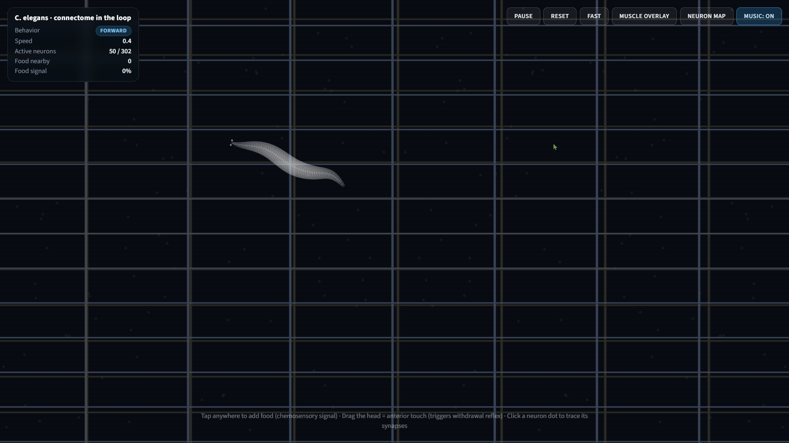
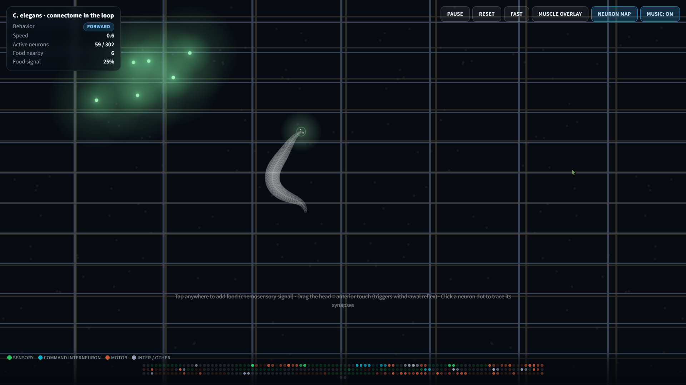

# C-GenRWorm Simulation

A single-file HTML worm simulation — the full *C. elegans* 302-neuron connectome running in your browser, with emergent locomotion and no build step. Created by @CJ-Mars19x.

## What it does

A biomechanical spring-chain worm driven by a real neural model (OpenWorm/c302-inspired). It crawls, reverses, and forages on its own — and you can poke it: drop food anywhere and it steers toward the chemosensory signal; drag its head and the touch reflex makes it back up. A live HUD tracks behavior, speed, active neurons, and food signal.

**Highlights:** clickable neuron map (trace any neuron's synapses), muscle overlay toggle, Slow/Fast/Faster speed, pause & reset, and embedded looped background music.

**Custom background:** the scene uses `C-GenRWorm_Background.png` (cover-fit, with a dark overlay). Swap in your own image with that filename to reskin it.

## Run it

Download the repo as a **ZIP file**, extract it, and open the HTML file inside. That's the whole install — it runs entirely client-side.

| Input | Effect |
| --- | --- |
| Click / tap | Add food (chemosensory signal) |
| Drag the head | Anterior touch → withdrawal reflex |
| Click a neuron dot | Trace its synapses |
| Toolbar buttons | Pause · Reset · Speed · Muscle overlay · Neuron map · Music |

## System Requirements

**Browsers:** Edge, Chrome, Brave, Firefox, Safari (all latest), or any modern Chromium-based browser.

**Required:** JavaScript enabled, HTML5 Canvas 2D, modern CSS3, ES2015+.
**Optional:** `backdrop-filter` (glass UI blur) and base64 audio/image decode (background music + custom background).

**Minimum:** Fast dual-core x86-64 or ARM CPU · integrated or dedicated GPU with hardware acceleration on · 2 GB RAM · Windows 10+, Android 9+, latest iOS/iPadOS/macOS/Linux · mouse/trackpad/touch · 60 Hz display.

**Recommended:** 4-core+ x64/ARM CPU · modern integrated or dedicated GPU (hardware acceleration on) · 4–8 GB RAM · Windows 10+, Android 11+, latest iOS/iPadOS/macOS/Linux · 60 Hz+ display.

If it runs choppy, flip on hardware acceleration in your browser — that's almost always the fix.

## Music Background

[BandLab](https://www.bandlab.com/track/ec832745-651a-45aa-89e5-9f9c3e28a721?revId=393144a7-b371-4ddc-a2e4-d51073914f62)

## Screenshots

